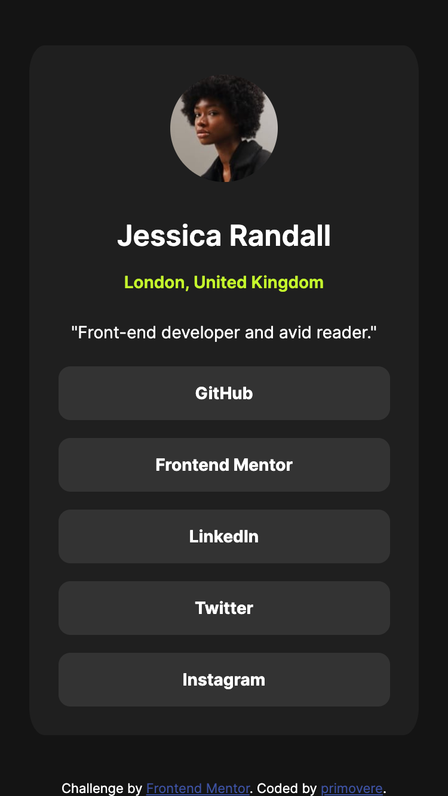
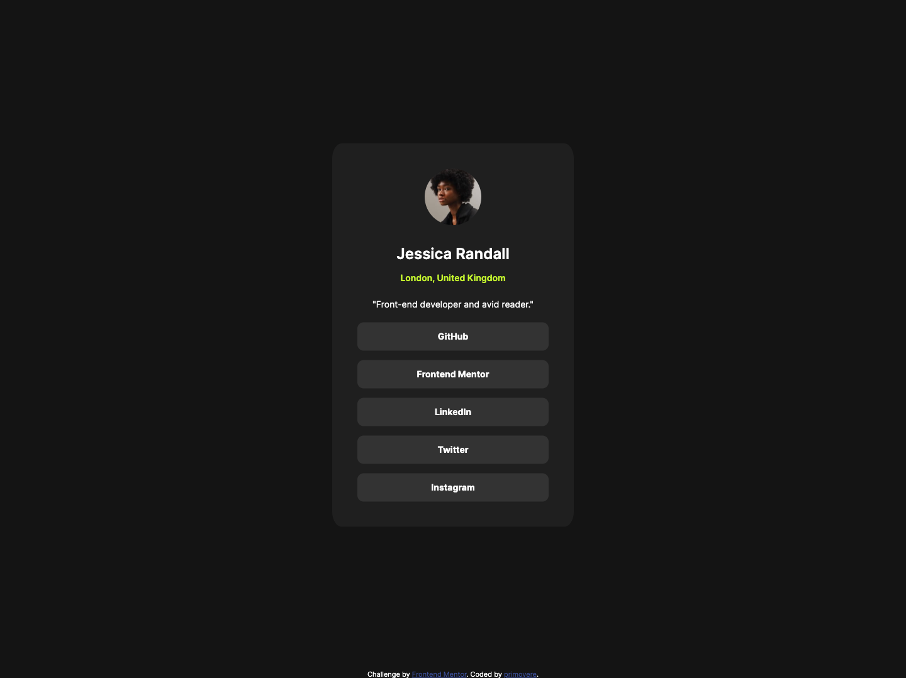

# Frontend Mentor - Social links profile solution

This is a solution to the [Social links profile challenge on Frontend Mentor](https://www.frontendmentor.io/challenges/social-links-profile-UG32l9m6dQ).

## Table of contents

- [Overview](#overview)
  - [The challenge](#the-challenge)
  - [Screenshot](#screenshot)
  - [Links](#links)
- [My process](#my-process)
  - [Built with](#built-with)
  - [What I learned](#what-i-learned)
  - [Useful resources](#useful-resources)

## Overview

### The challenge

Users should be able to:

- See hover and focus states for all interactive elements on the page

### Screenshot




### Links

- Solution URL: [Social links profile solution page](https://www.frontendmentor.io/solutions/responsive-social-link-file-using-flexbox-kcYTOkr7lo)
- Live Site URL: [Live site](https://primovere.github.io/social-links-profile/)

## My process

### Built with

- Semantic HTML5 markup
- CSS custom properties
- Flexbox
- Mobile-first workflow

### What I learned

#### HTML

- Ask "Is it a chapter title?" before choosing a heading element. Use `<h1>` for the page title and `<p>` for ordinary lines of text.

#### CSS reset

- `*` means "every element in the HTML".
- `::before` and `::after` are pseudo-elements: extra pieces CSS can attach to an element. `*` doesn't match them, so they are listed separately.
- `box-sizing: border-box` makes padding and border count inside the width and height, so there is no confusion about element size.

```css
*,
*::before,
*::after {
  box-sizing: border-box;
}
```

#### Variables and fonts

- `:root` means "the very top element of the page", which is `html`.
- `:root` signals that these are global values, and its specificity is higher than `html`.
- Fonts are inherited, so set `font-family` once on `body`.
- Careful with `font-size` on `html` or `:root`: it changes what `1rem` means for the whole page.

#### Box model and sizing

- Font size changes how tall the card ends up, but it doesn't change the padding. The two don't depend on each other.
- Don't set a fixed `height` on the card. Its height comes from its content plus its padding.

#### Circle avatar

- `border-radius: 999px` works because the browser caps the rounding at the biggest curve that fits.
- `border-radius: 50%` means "round the corners by half the box's width and height". On a square this gives a circle; on a non-square box it gives an ellipse (while `999px` gives a pill shape).

#### Links

- Make the links container stretch to the card's content edges, and center the text inside each button.

```css
.links {
  align-self: stretch;
}

.social-link {
  text-align: center;
}
```

- To check `:hover` in DevTools device mode, choose "mobile (no touch)". Touch emulation treats the mouse like a finger, so the hover effect only appears after clicking.

#### Responsive card

- `width` asks for a size; `max-width` only sets a ceiling. `clamp(min, preferred, max)` lets a value change smoothly between two limits.

```css
.card {
  width: 87%;
  max-width: 384px;
  padding: clamp(24px, 6.5vw, 40px);
}
```

- A `clamp()` on the links' left and right padding changed nothing visible, because the links are already stretched and their text is centered.

#### Page layout (footer at the bottom, card centered)

- `min-height: 100vh` on `body` means "at least as tall as the viewport", but it doesn't limit the maximum height. If the content is taller than the viewport, `body` grows with it and the page scrolls.
- `flex: 1` on `main` gives it the leftover space. It doesn't force the card to shrink.
- `flex-shrink: 1` allows shrinking, but a flex item still can't go below its minimum content size.
- Flex items default to `min-height: auto` (in a column container).

```css
body {
  min-height: 100vh;
  display: flex;
  flex-direction: column;
}

main {
  flex: 1;
  display: flex;
  justify-content: center;
  align-items: center;
}
```

#### DevTools tips

- `scrollHeight` shows the height the content actually needs.
- `innerHeight` shows the height of the current layout viewport.
- (To verify) In device mode, the Scale setting may change the viewport height DevTools reports. I should test this myself before keeping it.

### Useful resources

- [An Interactive Guide to Flexbox](https://www.joshwcomeau.com/css/interactive-guide-to-flexbox/) - This helped me understand flexbox better.
